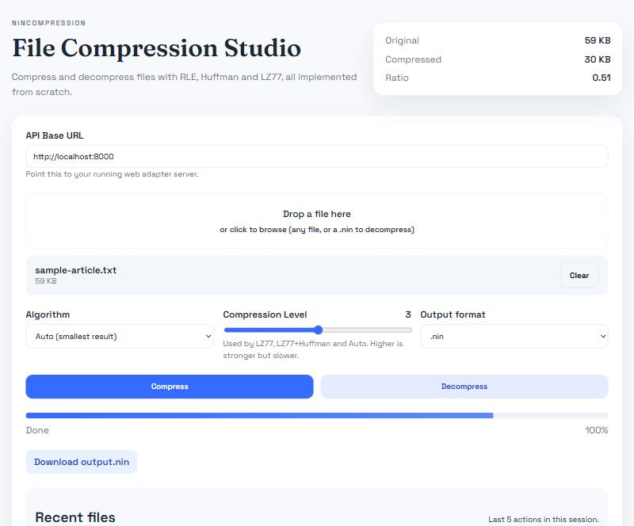

# NinCompression

A file compressor written from scratch in Python, with no compression libraries. It implements four algorithms (RLE, Huffman, LZ77, and LZ77 followed by Huffman), a checksummed `.nin` file format, a command-line tool, a small HTTP server, and a React web interface.

<p align="center">
  
</p>

## Features

- **Four algorithms**, each with its own encoder and decoder:
  - **RLE**: run-length encoding for long runs of the same byte.
  - **Huffman**: a binary Huffman tree built from byte frequencies, stored compactly in the file.
  - **LZ77**: a sliding-window dictionary coder (4 KB window, 5 levels) that finds matches with a hash table.
  - **LZ77 + Huffman**: LZ77 first, then Huffman coding on its output.
- **Auto mode** (the default): tries every algorithm and keeps the smallest result. If nothing helps, the data is stored unchanged, so a file never grows by more than the header.
- **Integrity checking:** every file carries a CRC-32 of the original data, and decompression fails with a clear error if the file is damaged.
- **Command-line tool, HTTP server, and web UI** that all share the same code.
- **Tested:** 65 unit tests, including random-data round trips, window-edge cases, corrupt and truncated input, the command line, and the HTTP server.

## Quick start

Requires Python 3.9 or newer (tested on 3.9 and 3.13). There are no dependencies.

```bash
# Compress (auto picks the best algorithm) and decompress
python main.py compress notes.txt notes.nin
python main.py decompress notes.nin notes_restored.txt

# Pick an algorithm and an LZ77 level (1-5)
python main.py compress -a lz77h --level 5 notes.txt notes.nin

# Inspect a file and verify its checksum
python main.py info notes.nin
```

```text
$ python main.py compress notes.txt notes.nin
notes.txt -> notes.nin  [lz77h]  8800 -> 884 bytes (10.0%)

$ python main.py info notes.nin
Format version: NIN2
Algorithm: lz77h
Original size: 8800 bytes
Compressed size: 884 bytes
Compression ratio: 0.100
Decompression time: 0.0083s
Checksum: CRC-32 72c6b68e verified
```

You can also compress short strings to hex, which is handy for seeing how the formats work:

```bash
python main.py compress-string -a rle "AAABBBCCDAA"          # prints 03410342024301440241
python main.py decompress-string -a rle 03410342024301440241   # prints AAABBBCCDAA
```

Errors are reported as one-line messages (for example `error: Checksum mismatch; the file is corrupted.`) and a non-zero exit code.

## Web interface

The web UI talks to a small server built on the standard library.

```bash
# Terminal 1: the server on http://127.0.0.1:8000
python web_adapter.py

# Terminal 2: the UI on http://127.0.0.1:5173 (needs Node.js)
cd web_ui
npm install
npm run dev
```

Drop a file in, pick an algorithm and level, and download the `.nin` (or a `.zip` containing it). The server listens on localhost only and refuses uploads over 64 MB. It exposes `POST /compress`, `POST /decompress`, and `POST /info`.

## How it works

| Algorithm | Idea | Good for | Weakness |
| --- | --- | --- | --- |
| RLE | Replace runs with `(count, byte)` pairs | Long runs (blank regions, simple graphics) | Doubles the size of data without runs |
| Huffman | Shorter bit codes for common bytes | Skewed byte frequencies (text) | Can't exploit repeated phrases |
| LZ77 | Replace repeats with `(distance, length)` back-references | Repeated phrases and structure | Fixed 4-byte tokens: unmatched bytes cost 4 bytes each |
| LZ77 + Huffman | LZ77, then Huffman on the token stream | Text and structured data | Slowest to compress |

LZ77 finds matches with a hash table keyed on the next three bytes, so each position only checks a limited number of earlier positions (8 to 128, depending on the level) rather than scanning the whole window.

### The `.nin` format

```text
[NIN2][alg_len][alg_name][original_size][crc32][payload]
  4 B     1 B    UTF-8      8 B big-endian  4 B   compressed data
```

`crc32` is the CRC-32 of the original data. Files from the first version of the tool (`NIN1`, no checksum) are still readable.

Payload layouts:

- **RLE:** pairs of `(count, byte)`, each count 1 to 255.
- **Huffman:** `[tree_bits_len: 4 B][data_bits_len: 4 B][tree bits][data bits]`.
- **LZ77:** 4-byte tokens `[offset: 2 B][flag + length: 1 B][next byte: 1 B]`, with offsets up to 4096 and lengths up to 18.
- **Store:** the data unchanged.

## Benchmarks

`python tools/benchmark.py` runs every algorithm on four datasets and checks the round trip. Ratios below are compressed size divided by original size (lower is better). zlib is included only as a yardstick; none of the algorithms use it.

| Dataset | RLE | Huffman | LZ77 | LZ77 + Huffman | zlib (reference) |
| --- | --- | --- | --- | --- | --- |
| One sentence repeated (8.8 KB) | 2.00 | 0.56 | 0.23 | **0.10** | 0.01 |
| Random words (30 KB) | 1.97 | **0.49** | 0.63 | 0.50 | 0.29 |
| `ABCD` repeated (8 KB) | 2.00 | 0.25 | 0.21 | **0.07** | 0.00 |
| Random bytes (4 KB) | 1.99 | **1.08** | 4.00 | 1.82 | 1.00 |

What this shows:

- The best algorithm depends on the data, which is why auto mode exists. On random bytes, nothing helps, and auto stores the data as-is.
- The from-scratch coders are correct but not competitive with zlib, which combines LZ77 with much more compact tokens and Huffman-coded lengths and distances.
- RLE and LZ77 can expand data they don't suit.

Compression time at the default level is about 0.3 s for 100 KB of text. Decompression is faster.

## Tests

```bash
python -m unittest discover -s tests
```

## Limitations

- It is pure Python, so it is far slower than C implementations such as zlib. Files are read fully into memory, so it is not meant for very large files.
- LZ77 uses a 4 KB window and 4-byte tokens, which is simple but limits the ratio.
- Tiny files get bigger: the container header alone is about 24 bytes.
- There is no encryption and no support for compressing multiple files or directories.

## Project structure

```text
main.py                    command-line tool and shared compress/decompress functions
web_adapter.py             HTTP server (standard library only)
compressor/
    base.py                algorithm interface and registry
    rle.py  huffman.py  lz77.py  lz77_huffman.py  store.py
utils/
    file_format.py         the .nin container (NIN2 with CRC-32, NIN1 for reading)
    file_io.py
tools/benchmark.py         benchmark script
tests/                     unit tests
web_ui/                    React + Vite web interface
```

## Author

Nithin Sai Ega · [GitHub](https://github.com/nithin-sai-ega) · [LinkedIn](https://www.linkedin.com/in/nithin-sai-ega/)
